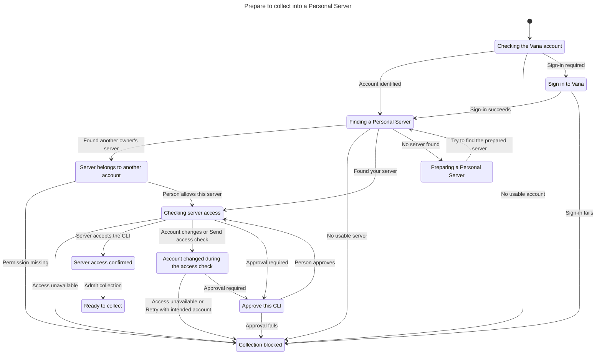
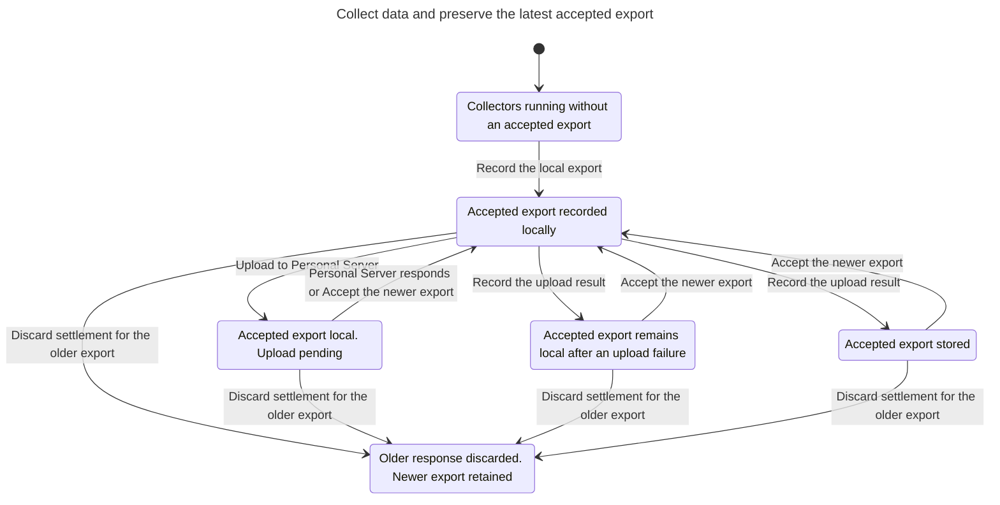
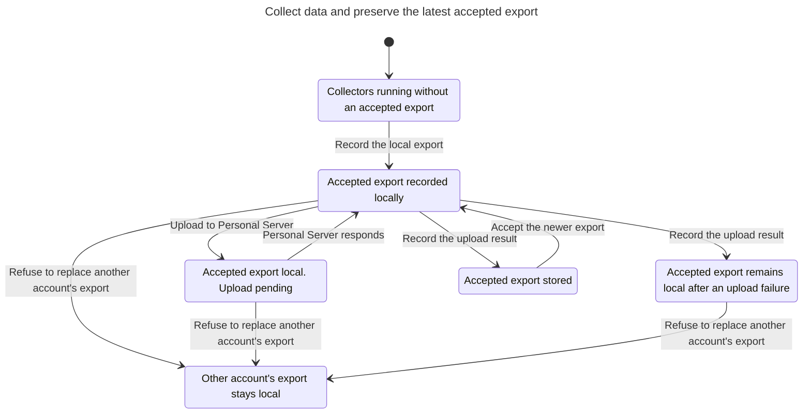
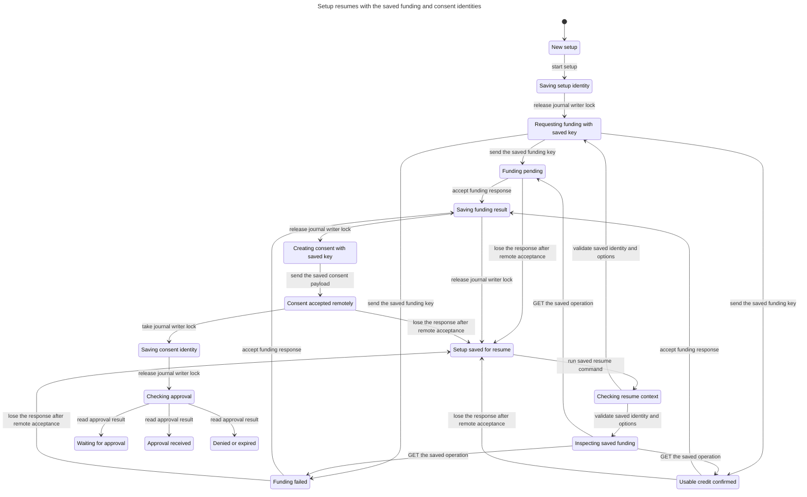
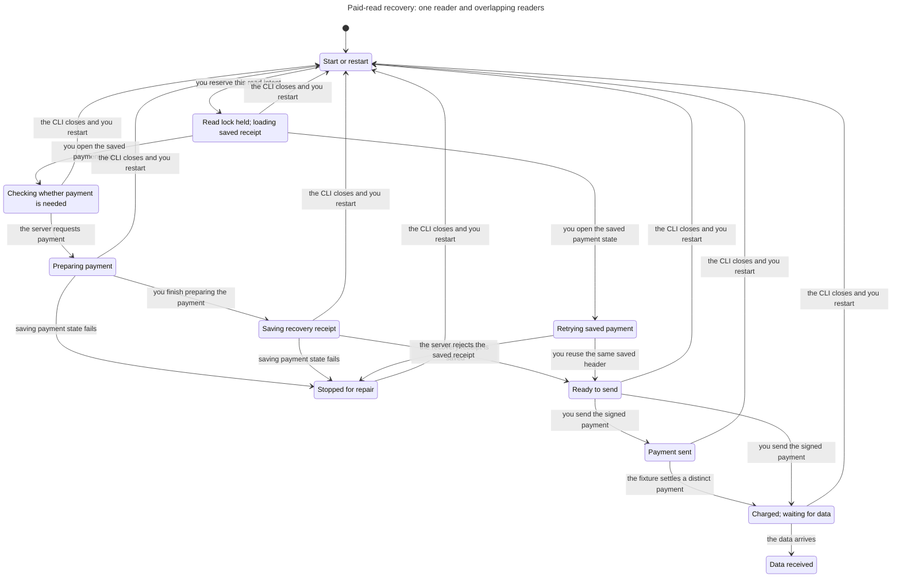
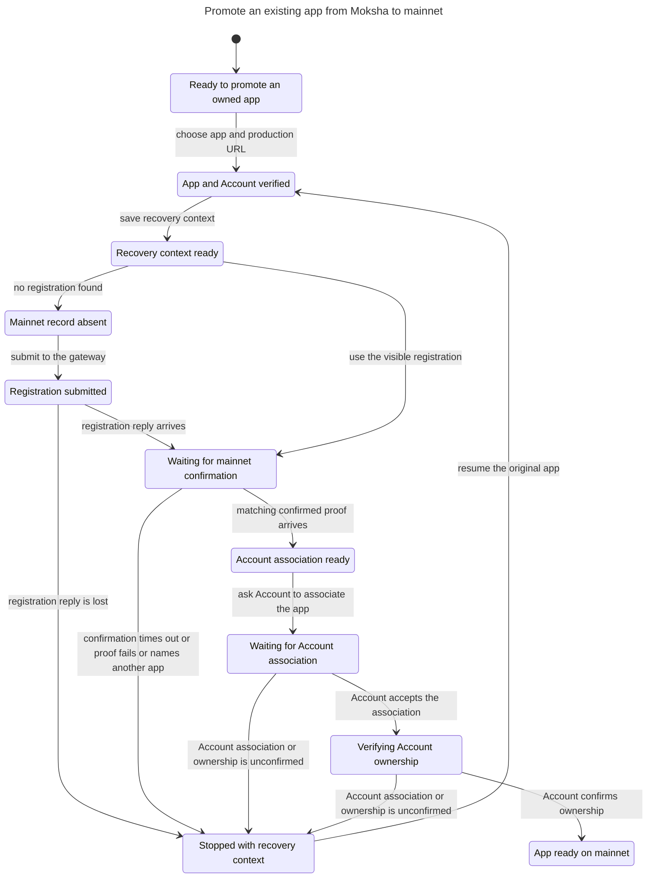
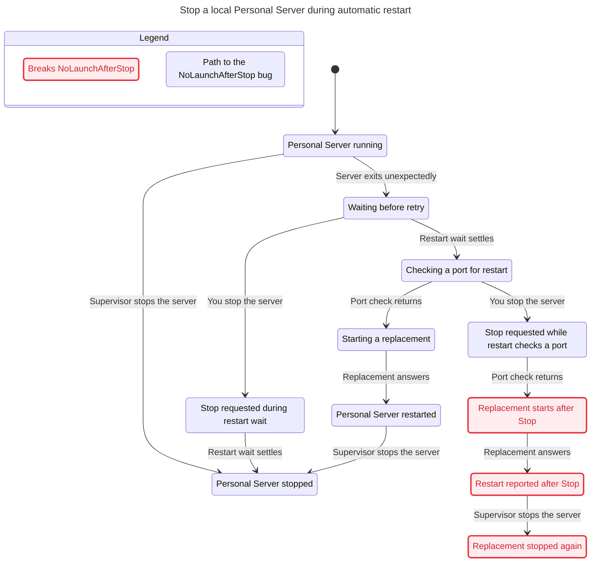
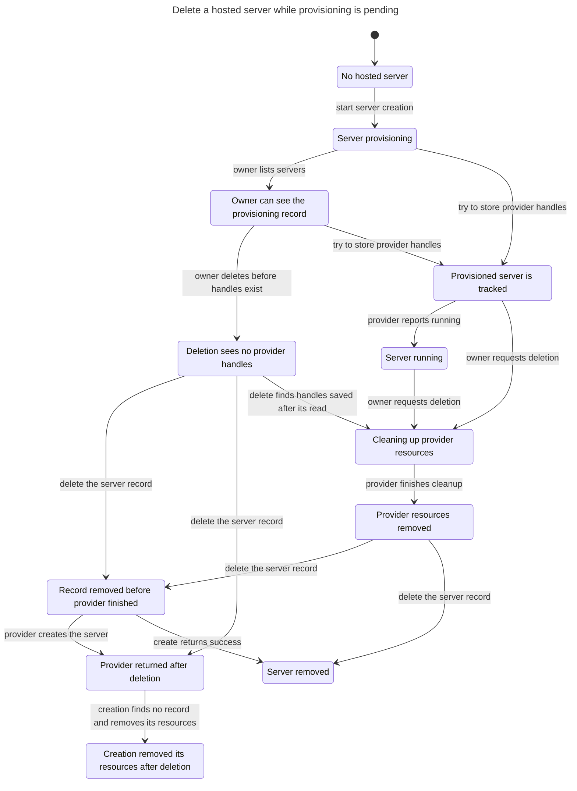

# Vana CLI statecharts

[Source inventory and verifier entry points](STATE-MACHINE-INVENTORY.md)

Each TLC report records the state count and omitted steps that stay in the same label. Use the model owner’s README for exact bounds and excluded behavior.

To redraw a model, copy its model directory to scratch. Set the Pstack Statechart executable and select the TLA+ module, config, and view named in the proof owner.

```sh
$STATECHART "$scratch/$module.tla" --config "$scratch/$config.cfg" --view "$scratch/$view.mjs" --out "$(mktemp -d)/chart"
```

## Prepare to collect a source

Confirm an eligible Personal Server before collection. A late approval cannot authorize an obsolete owner.



## Save collected data and retry upload

A late upload can settle only the generation it started with.



## Switch accounts with an upload still pending

A foreign collection must leave the pending bytes and receipt with their owner.



## Set up a builder request and resume

Persist recovery identity, wait for usable credit, then create consent. The chart uses the small overview configuration.



## Recover an interrupted paid read

Reuse the saved payment identity and keep overlapping readers from paying again. The chart shows the single-reader profile.



## Register an app on mainnet

A matching confirmed Gateway read must precede Account association. Ownership confirmation clears the saved recovery context.



## Stop a local server while it restarts

Current behavior. Stop during a pending restart port check can still start the replacement.



## Delete a hosted server during provisioning

Current behavior. A delete that arrives before the provider returns removes the untracked row, and the create then removes what it made and answers 409. A delete that read the row before the handles were saved finds them on a second read and deprovisions them. A create killed at its time limit is not modelled.


